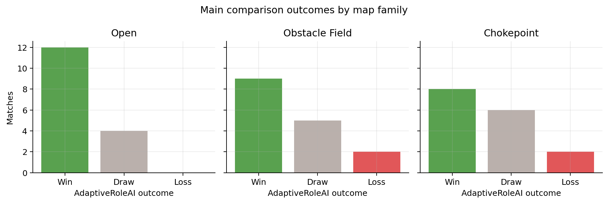
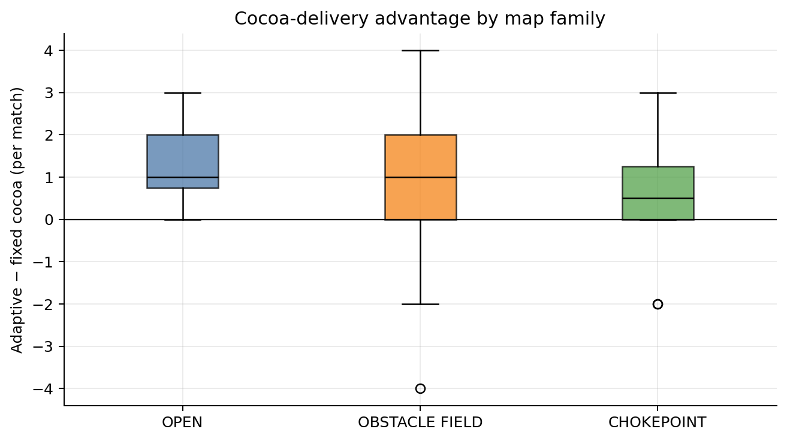
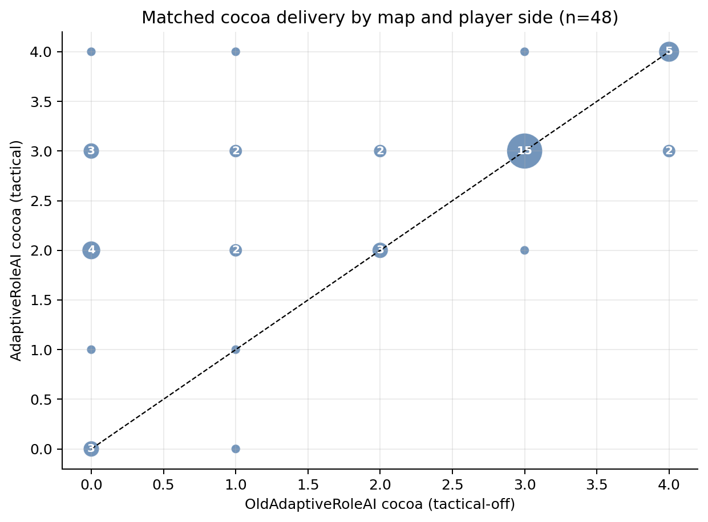
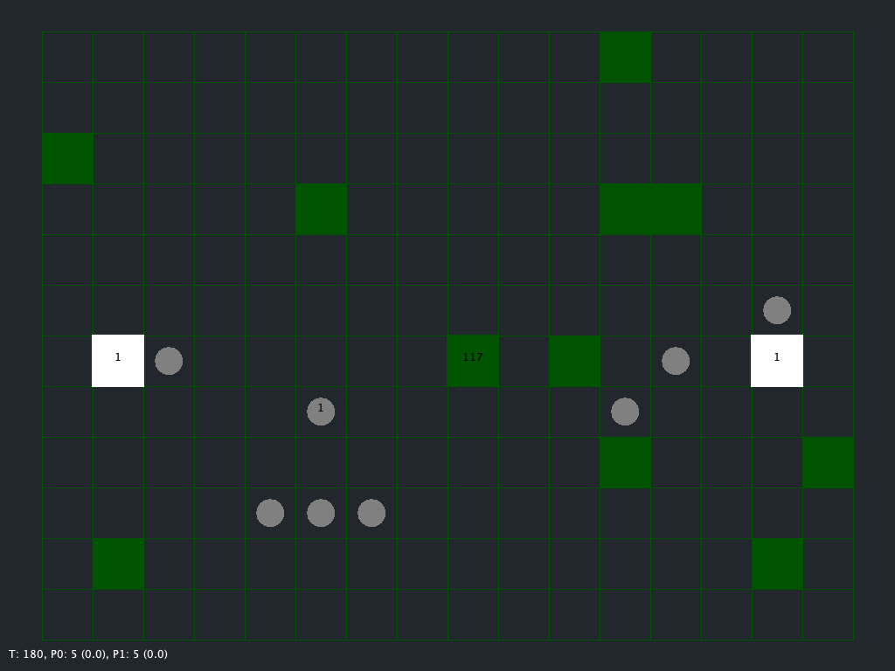
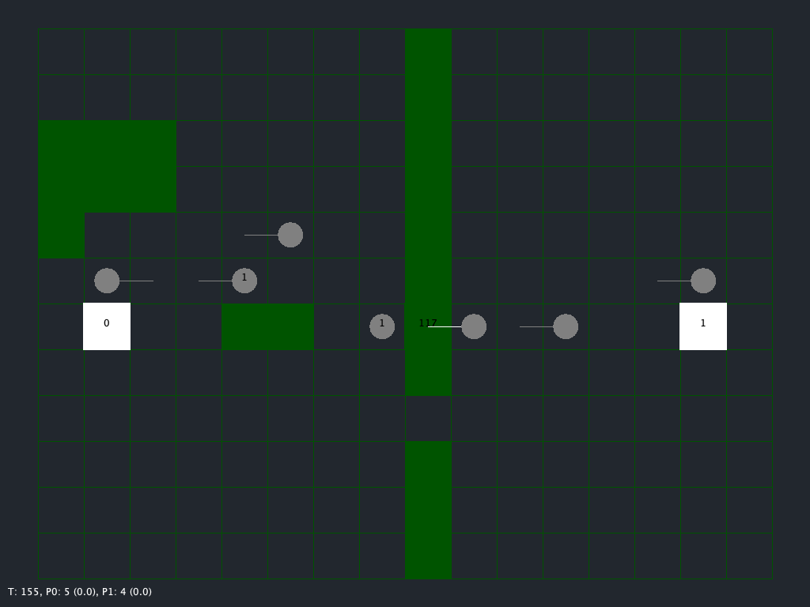
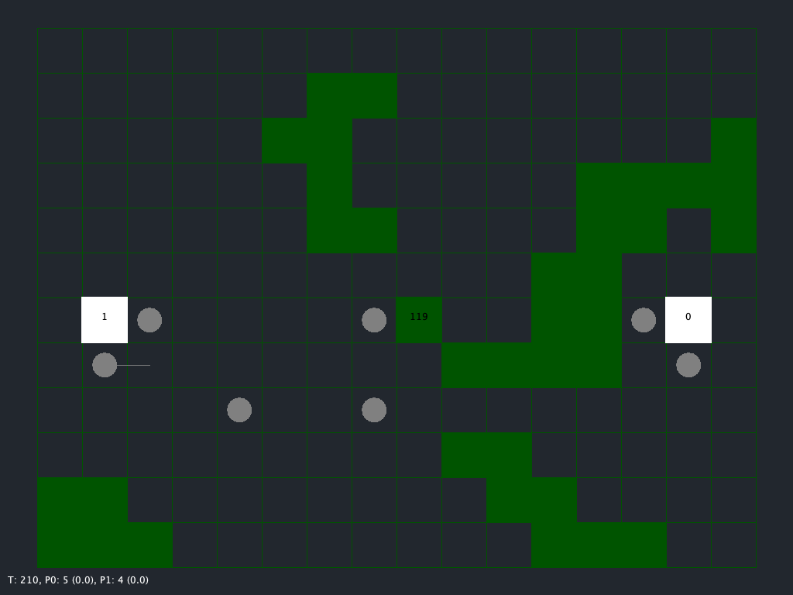
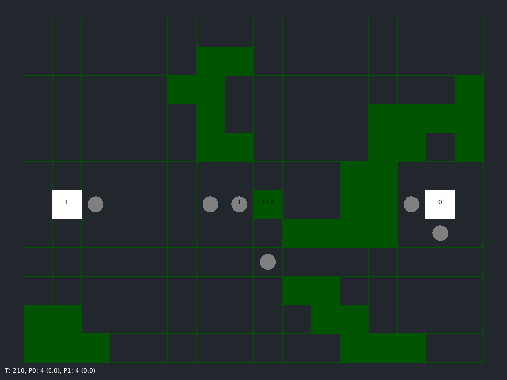

# 🍫 Factory Feud
### Adaptive Team AI Meets Procedurally Generated Battlefields


**Can an AI team that adapts its roles and responds to threats outperform a team following fixed roles?**

Factory Feud explores this question through a competitive real-time strategy game built on [microRTS](https://github.com/Farama-Foundation/MicroRTS).

Two AI-controlled teams race to collect cocoa from a shared resource while defending their factories, protecting teammates, and surviving enemy attacks.

The project combines **dynamic role assignment, threat-aware tactical decisions, procedural map generation, and automated experimental evaluation**.

---

## 🎮 The Game

| Game mechanic | Description |
|---|---|
| 🏭 Teams | 2 competing factories |
| 🤖 Units | 4 Workers per team |
| 🍫 Resource | 120 cocoa at one shared node |
| ⚔️ Combat | 1 HP per Worker |
| ⏱️ Duration | 500 simulation cycles |
| 🏆 Victory | Most cocoa delivered wins |
| 🚫 Production | Disabled; eliminated Workers cannot respawn |

Workers must balance cocoa collection, escorting teammates, attacking opponents, and defending their factory.

**Every decision matters.** Losing a Collector can stop a fixed-role team's resource collection, while the adaptive team can assign another surviving Worker to the task.

### Meet the Teams

🔵 **FixedRoleAI | Blue Team**

Each Worker permanently receives one role. Workers react to changing game conditions but never switch responsibilities.

🩷 **AdaptiveRoleAI | Pink Team**

Workers dynamically change responsibilities as the game evolves. A threat-aware tactical layer can temporarily override their normal actions to retreat or counterattack.

---

## 🧠 How the AI Works

### Four Roles, One Team

| Role | Responsibility |
|---|---|
| 🍫 **Collector** | Harvest cocoa and deliver it to the factory |
| 🛡️ **Escort** | Protect Collectors from nearby threats |
| ⚔️ **Attacker** | Intercept and attack enemy Workers |
| 🏰 **Defender** | Protect the factory and nearby teammates |

### Fixed Strategy vs Adaptive Strategy

**FixedRoleAI**

```text
Observe GameState
       ↓
Follow permanently assigned role
       ↓
Choose target and issue action
       ↓
Repeat
```

**AdaptiveRoleAI**

```text
         Observe GameState
                ↓
       Evaluate Team Needs
                ↓
        Reassign Roles
          (if needed)
                ↓
      Check Immediate Threats
                ↓
      ┌─────────┼─────────┐
      ↓         ↓         ↓
   Retreat   Counter-   Continue
              attack     Role
      └─────────┼─────────┘
                ↓
        Execute via microRTS
                ↓
          Next Game Cycle
```

The adaptive controller reevaluates strategic role assignments every 10 cycles and ordinarily applies a 25-cycle reassignment cooldown, with exceptions for emergencies.

Its tactical layer considers nearby enemy reach, attack timing, possible lethal counterattacks, and safer movement positions.

**The key distinction:** Strategic decisions change *what a Worker is responsible for*. Tactical decisions temporarily change *what the Worker does right now*.

The project uses microRTS's existing movement, combat, harvesting, and A* pathfinding facilities.

---

## 🗺️ Procedural Map Generation

Instead of testing only on handcrafted maps, Factory Feud includes a custom procedural generator that creates unfamiliar environments for the competing AI teams.

### Three Map Families

| 🌿 OPEN | 🧱 OBSTACLE_FIELD | 🚧 CHOKEPOINT |
|---|---|---|
| Scattered obstacles | Clustered walls and alternative routes | Dividing barriers and narrow passages |
| Relatively open movement | More complex navigation | Restricted movement and contested access |

The generator supports configurable map dimensions, obstacle density, random seeds, and generation retries.

Every candidate map is automatically validated to ensure that the required units, factories, and cocoa are correctly placed and reachable. Invalid candidates are rejected and regenerated.

### Generation Results


| Family | Accepted maps |
|---|---:|
| OPEN | 40 |
| OBSTACLE_FIELD | 40 |
| CHOKEPOINT | 40 |
| **Total** | **120** |

The generator accepted 120 maps from 122 raw candidates. Two invalid CHOKEPOINT candidates were rejected because of unreachable cocoa routes.

Each generated map is exported as a standard microRTS XML file.

---

## 🏆 Experimental Results

### 24 Generated Maps · 96 Matches · 3 Hypotheses

We evaluated the strategies across 24 reproducibly selected generated maps, using balanced terrain families and density presets.

Each AI configuration was tested on both player sides to help account for positional advantages.

### Overall Performance


| Metric | Threat-aware adaptive AI | Fixed-role AI |
|---|---:|---:|
| Mean cocoa delivered | **2.625** | 1.792 |
| Match wins | **29** | 4 |
| Draws | 15 | 15 |

The adaptive controller finished with **29 wins, 15 draws, and 4 losses** across 48 main-comparison matches.



### Does Terrain Matter?

We predicted that chokepoint maps would increase the advantage of adaptive coordination.

Instead, the adaptive controller achieved its largest cocoa-delivery advantage on OPEN maps.

| Map family | Mean adaptive cocoa advantage |
|---|---:|
| OPEN | **+1.125** |
| OBSTACLE_FIELD | +0.813 |
| CHOKEPOINT | +0.563 |



Further analysis indicated that the smaller advantage on CHOKEPOINT maps primarily reflected stronger FixedRoleAI delivery, rather than lower delivery by the adaptive controller.

### Do Tactical Decisions Help?

To isolate tactical behavior, we compared the adaptive controller with and without its threat-aware tactical overrides, using identical maps and player-side assignments.

| Metric | Tactical AI | Without tactics |
|---|---:|---:|
| Mean cocoa | **2.625** | 2.000 |
| Mean surviving Workers | **2.979** | 2.167 |
| Mean Worker deaths | **1.021** | 1.833 |
| Wins / Draws / Losses | **29 / 15 / 4** | 20 / 14 / 14 |

**Threat-aware tactics improved average cocoa delivery by 31.25%**, while also improving Worker survival.

Across the experiment, the tactical controller recorded **96 counterattacks and 229 retreats**.



### Hypothesis Summary

| Hypothesis | Prediction | Outcome |
|---|---|---|
| H1: Overall performance | At least 70% strict wins | ❌ 60.42% |
| H2: Map complexity | CHOKEPOINT advantage at least 2 cocoa above OPEN | ❌ −0.563 |
| H3: Tactical effectiveness | At least 15% more cocoa | ✅ +31.25% |

The results show that adaptive strategies can improve performance, but their effectiveness depends on terrain structure and the balance between defensive behavior and resource collection.

---

## 📸 Gameplay Gallery

### 🌿 OPEN Map



*Match 6, cycle 180. Both AI teams compete on a generated OPEN map.*

### 🚧 CHOKEPOINT Map



*Match 66, cycle 155. Restricted routes change how units approach the shared cocoa resource.*

### ⚔️ Tactical AI vs Tactical Ablation

| With tactical decisions | Without tactical decisions |
|---|---|
|  |  |

*Matched experiments at cycle 210. The tactical controller preserved one additional Worker but delivered one less cocoa by match end, illustrating the tradeoff between survival and collection throughput.*

---

## 🔬 What We Learned

**1. Adaptation is useful, but more adaptation is not always better.**

The adaptive strategy generally outperformed the fixed baseline, yet repeated role switching sometimes interrupted collection. One match recorded 29 role changes involving Collector, Defender, and Escort responsibilities.

**2. Staying alive doesn't automatically mean winning.**

Retreating can preserve Workers, but it can also delay cocoa deliveries. Other matches showed the opposite tradeoff: more cocoa delivered despite fewer surviving Workers.

**3. The environment changes the competition.**

Increasing obstacle density and route complexity did not uniformly favor the adaptive strategy. Different map layouts changed navigation costs, encounters, and the relative effectiveness of each controller.

**4. Procedural generation makes evaluation more informative.**

Testing across varied, previously unseen generated maps revealed strengths and weaknesses that were harder to observe on the five original handcrafted maps.

---

## 🚀 Getting Started

### Requirements

- Java JDK
- Apache Ant
- Python 3 with `matplotlib` for analysis plots
- A graphical desktop for the visualizer

Run all commands from the repository root containing `build.xml`.

### Build

```bash
ant clean build
```

### Run Factory Feud

```bash
ant factory-feud-visual
```

Default teams:
- 🔵 Player 0: FixedRoleAI
- 🩷 Player 1: AdaptiveRoleAI

### Run the Handcrafted-Map Evaluation (D1)

```bash
ant factory-feud-evaluate
```

### Generate Procedural Maps (D2)

```bash
ant factory-feud-generate
```

Generate distribution plots:

```bash
ant factory-feud-plot
```

Run generation tests:

```bash
ant factory-feud-generation-tests
```

### Explore Generated Maps

**OPEN**

```bash
ant -Dfactoryfeud.visual.map=maps/factory-feud/generated/factory-feud-pcg-v1-open-001-sparse-seed-584000-16x12.xml factory-feud-visual
```

**OBSTACLE_FIELD**

```bash
ant -Dfactoryfeud.visual.map=maps/factory-feud/generated/factory-feud-pcg-v1-obstacle-field-019-medium-seed-1584018-16x12.xml factory-feud-visual
```

**CHOKEPOINT**

```bash
ant -Dfactoryfeud.visual.map=maps/factory-feud/generated/factory-feud-pcg-v1-chokepoint-001-sparse-seed-2584000-16x12.xml factory-feud-visual
```

### Run a Headless Generated-Map Match

```bash
ant -Dfactoryfeud.ai.map=maps/factory-feud/generated/factory-feud-pcg-v1-chokepoint-001-sparse-seed-2584000-16x12.xml factory-feud-ai-smoke
```

### Reproduce the D3 Experiments

```bash
# Build and run D3 tests
ant clean build
ant factory-feud-d3-tests

# Optional short smoke experiment
ant factory-feud-d3-smoke

# Full 96-match evaluation
ant factory-feud-d3-experiment

# Generate statistical plots
ant factory-feud-d3-plot

# Reproduce gameplay screenshots
ant factory-feud-d3-captures
```

The full D3 evaluation runs 96 matches of 500 cycles each. Its outputs are reproducible using the recorded configuration and seeds.

### Tests

```bash
ant factory-feud-generation-tests
ant factory-feud-d3-tests
```

The complete upstream `ant test` suite may require an additional BroodWar map fixture for `TestTracesIntegrity`.

---

## 📂 Project Structure

```text
MicroRTS/
├── src/courseproject/factoryfeud/
│   ├── FactoryFeudRoleAI.java
│   ├── FixedRoleAI.java
│   ├── AdaptiveRoleAI.java
│   ├── OldAdaptiveRoleAI.java
│   └── ... generator and experiment modules
│
├── maps/factory-feud/
│   └── generated/             # Procedural XML maps
│
├── test/courseproject/factoryfeud/
│                              # Automated tests
│
├── scripts/
│   └── factory_feud_d3_analysis.py
│
├── results/
│   ├── factory-feud-d2/       # Generation statistics
│   └── factory-feud-d3/
│       ├── match-results.csv
│       ├── selection-manifest.csv
│       ├── summary.md
│       ├── plots/
│       └── gameplay-captures/
│
├── docs/
│   ├── FACTORY_FEUD_D2.md
│   └── FACTORY_FEUD_D3.md
│
└── build.xml
```

## 📚 Documentation

- [Deliverable 2: Procedural Map Generation](docs/FACTORY_FEUD_D2.md)
- [Deliverable 3: Integrated Evaluation](docs/FACTORY_FEUD_D3.md)
- [D3 Experiment Summary](results/factory-feud-d3/summary.md)
- [D3 Unusual Match Analysis](results/factory-feud-d3/unusual-match-analysis.md)

## 🛠️ Technology Stack


## 🙌 Credits and Attribution

**Developed by Rishitha Ramesh and Digvijay Sonvane**  
CSC 584: Building Artificial Intelligence for Computer Games  
North Carolina State University, Fall 2026

Factory Feud's scenario, strategic controllers, tactical behavior, handcrafted maps, procedural generator, validity checks, evaluation framework, and visualization integration were developed by our team.

The underlying game engine, simulation, pathfinding, action execution, and rendering infrastructure are provided by the open-source [microRTS project](https://github.com/Farama-Foundation/MicroRTS).

No upstream microRTS engine changes were required for Factory Feud.

---

<div align="center">

### 🍫 Collect. Adapt. Defend. Deliver.

**The same AI can face a different battle on every generated map.**

⭐ If you find this project interesting, consider starring the repository!

</div>